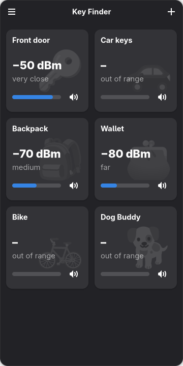
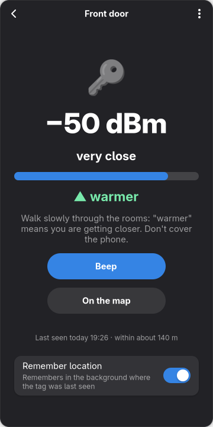
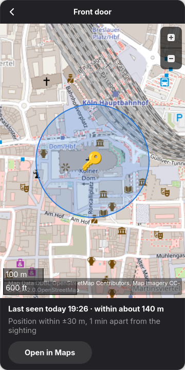
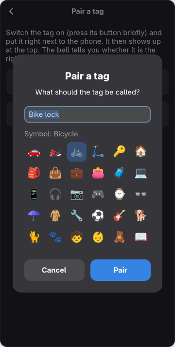

# Key Finder


---
⚠️ **AI-assisted project**  
Under active development. Features may change and instability is possible.

---

Find your keys with a cheap Bluetooth tag: make it beep, follow the signal,
see where it was last seen. Made for Linux phones (Phosh), tested on the
**FuriLabs FLX1s** with FuriOS. In English, German, French and Spanish – it follows
the system language, or pick one in the menu.

| Tags | Search | Last place seen | Pair a tag |
|:---:|:---:|:---:|:---:|
|  |  |  |  |

<sub>Invented tags (`tools/screenshots.sh`).</sub>

## What it does

- **Pair** a tag, give it a name and a symbol
- **Beep** – the tag rings until you stop it
- **Search** – signal strength with *warmer / colder* while you walk around
- **Last place seen** *(optional, per tag)* – shown on a map with the area it is in

## Install

```bash
flatpak install --user https://misc-de.github.io/KeyFinder/io.github.miscde.KeyFinder.flatpakref
```

That's all: x86_64 and aarch64, signed, the runtime comes from Flathub.
Update with `flatpak update`, remove with `flatpak uninstall io.github.miscde.KeyFinder`.

<details>
<summary>Without Flatpak</summary>

Needs Python 3 with GTK 4, libadwaita, libshumate (`gir1.2-shumate-1.0`) and BlueZ.

```bash
git clone https://github.com/misc-de/KeyFinder.git
cd KeyFinder && ./install.sh      # into ~/.local, no root
```

Remove with `./uninstall.sh`.
</details>

## Which tags work

Cheap **iTag-style** tags (a few euros, "iTag" / app "iSearching") – they speak the
standard *Immediate Alert* service. **Not** AirTag, Tile or Galaxy SmartTag: those
are encrypted and tied to their maker's app.

## Good to know

- **Last place seen** runs a small background service, only while at least one tag
  has the option on. Every minute it looks for tags for 10 s and asks for the
  position at most every 5 minutes – and right away when a tag goes missing.
- The phone asks once whether Key Finder may use the location.
- Indoors there is often no GPS position; then the last place outside is shown.
- The tag can only be heard while it is in Bluetooth range (about 10–30 m).

## Thanks

Key Finder stands on the shoulders of these projects:

- [GTK](https://gtk.org) and [libadwaita](https://gnome.pages.gitlab.gnome.org/libadwaita/) – the user interface
- [PyGObject](https://pygobject.gnome.org) – GTK and GLib from Python
- [BlueZ](https://www.bluez.org) – the Linux Bluetooth stack
- [GeoClue](https://gitlab.freedesktop.org/geoclue/geoclue) – the phone's position
- [libshumate](https://gitlab.gnome.org/GNOME/libshumate) – the map
- [OpenStreetMap](https://www.openstreetmap.org/copyright) – map data and tiles, © OpenStreetMap contributors
- [Noto Color Emoji](https://github.com/googlefonts/noto-emoji) – the symbols on the tiles
- [protobuf-c](https://github.com/protobuf-c/protobuf-c) – needed by libshumate
- [Flatpak](https://flatpak.org), [Flathub](https://flathub.org) and the GNOME runtime – packaging
- [Phosh](https://phosh.mobi) and [FuriLabs](https://furilabs.com) – the phone it was made on

## License

[MIT](LICENSE)
